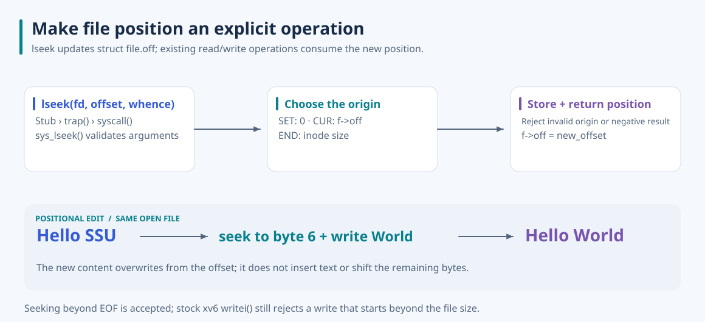

# xv6 File Positioning

**Edit a file at an explicit byte position.** I added `lseek` to xv6 and a shell command that repositions an open file, overwrites bytes, and shows the resulting contents.

Sequential reads and writes already advance `struct file.off`, but stock xv6 does not expose a call for choosing that offset. I added the missing operation at the syscall boundary and reused the existing file offset, so subsequent I/O follows the requested position through the normal file layer.



## How positioning works

`int lseek(int fd, int offset, int whence)` returns the new position, or `-1` on failure. The handler resolves the descriptor with `argfd`, fetches integer arguments, requires an inode-backed file, chooses an origin, and rejects a negative result before updating `f->off`.

| Origin | New position |
| --- | --- |
| `SEEK_SET` | `offset` |
| `SEEK_CUR` | Current `f->off + offset` |
| `SEEK_END` | Inode size plus `offset` |

The shared `struct file` is the source of file position. Descriptors referring to the same open file description, such as those produced by `dup` or inherited across fork, therefore observe the same offset. Seeking overwrites from a position on the next write; it does not insert bytes and shift the remaining file contents.

## Try a positional edit

Use Linux or WSL with Make, an x86 compiler supporting 32-bit output, binutils, and QEMU. The xv6 tree is contained in `xv6-public/`.

```bash
cd xv6-public
make CC=gcc-9 xv6.img fs.img
make CC=gcc-9 CPUS=1 qemu-nox
```

At the xv6 shell:

```text
echo Hello SSU > hello.txt
lseektest hello.txt 6 World
cat hello.txt
```

The fresh GCC 9 / single-CPU QEMU run changed `Hello SSU` to `Hello World`. `lseektest` opens the file for reading and writing, seeks back to print its contents, seeks to the requested offset, writes the replacement, and seeks back again for the after view. Exit QEMU with **Ctrl+A, then X**.

## Current boundaries

The syscall accepts a position beyond EOF, but stock xv6 `writei` rejects a write starting beyond the current file size; this does not implement sparse-file writes. The handler does not check signed addition overflow or add serialization around its offset update and inode-size read. Requiring `FD_INODE` also does not distinguish ordinary files from every other inode-backed object.

The demo uses a 256-byte buffer, reads the file size into it without a bound, and does not explicitly terminate the printed string. Use the small example above; the command is not a general file editor. Its `atoi` only consumes decimal digits, so a CLI argument such as `-1` becomes zero rather than exercising the syscall's negative-position rejection. The observed successful demo establishes the positional-edit path, not complete coverage of all three origins or error cases.

## Source

The handler is in [sysfile.c](xv6-public/sysfile.c), with constants in [fcntl.h](xv6-public/fcntl.h), user declarations in [user.h](xv6-public/user.h), and dispatch wiring in [syscall.c](xv6-public/syscall.c), [syscall.h](xv6-public/syscall.h), and [usys.S](xv6-public/usys.S). [lseektest.c](xv6-public/lseektest.c) implements the command. The plain [README](xv6-public/README) preserves upstream xv6 information and acknowledgments and is included by the filesystem-image build.

This earlier extension is separate from the later process-inspection syscall project. The collection's Linux observation report does not describe this lseek implementation. The SVG explains the source's offset flow, uses outlined Noto Sans, and includes its [font license](docs/assets/NotoSans-OFL.txt). See the [collection](https://github.com/jaeunda/xv6-kernel-extensions) for the other extensions.
